# PTZ Control

Eigen webbediening voor PTZOptics-camera's, te bedienen met muis/touch, toetsenbord of een Xbox-controller.

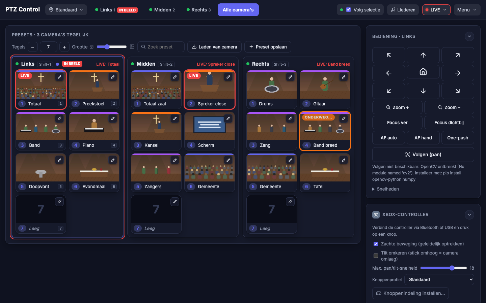

## Installeren en starten

**Eén bestand, één klik:** *Start PTZ Control* installeert waar nodig en start daarna de app. De eerste keer maakt hij de `.venv` (een paar minuten); na een update met gewijzigde `requirements.txt` werkt hij de packages vanzelf bij. Daarna opent de bediening in een eigen venster, zonder adresbalk en tabbladen (app-venster van Chrome of Edge; is geen van beide er, dan een gewoon tabblad in je standaardbrowser). Liever een gewoon tabblad: start met `--tab` of zet `PTZ_BROWSER=tab`.

| | Mac | Windows |
|---|---|---|
| Starten | dubbelklik **PTZ Control.app** (of *Start PTZ Control.command*) | dubbelklik **Start PTZ Control.bat**, daarna de snelkoppeling **PTZ Control** |
| In Dock / taakbalk | sleep **PTZ Control.app** naar het Dock | rechtsklik op **PTZ Control** in het Startmenu → *Aan taakbalk vastmaken* |
| Opnieuw installeren afdwingen | in Terminal: `bash "Start PTZ Control.command" --installeer` | in cmd: `"Start PTZ Control.bat" /installeer` |
| Snelkoppeling opnieuw maken | | in cmd: `"Start PTZ Control.bat" /snelkoppeling` |
| Vereist | Python 3.9+ (python.org of `brew install python`) | Python 3.9+ (python.org, vink *Add python.exe to PATH* aan, of `winget install -e --id Python.Python.3.12`) |

- **Mac – app-icoon:** *PTZ Control.app* moet in de map van PTZ Control blijven staan (hij start de starter uit die map). Sleep hem naar het Dock; dat maakt alleen een verwijzing. Draait de app al, dan opent een klik alleen de bediening (als app-venster). Anders opent Terminal met het logboek; dat venster sluiten = stoppen.
- **Mac:** meldt macOS "onbekende ontwikkelaar", rechtsklik → **Open** (eenmalig).
- **Windows – snelkoppeling:** de starter maakt bij de eerste keer de snelkoppeling **PTZ Control** met icoon in het Startmenu en op het bureaublad.
- **Windows:** vraagt de firewall om toegang, kies **Privénetwerken**, anders kunnen tablets de app niet bereiken.
  SmartScreen ("Windows heeft uw pc beschermd"): **Meer info → Toch uitvoeren**.
- **Windows met NVIDIA-videokaart:** het volgen gebruikt standaard de processor. Voor de GPU eenmalig:
  `.venv\Scripts\pip install torch --index-url https://download.pytorch.org/whl/cu124` (daarna rekent hij op `cuda`).
- Stoppen: sluit het venster van de starter.

Handmatig kan ook:
```
python3 -m venv .venv
.venv/bin/pip install -r requirements.txt
.venv/bin/python ptz_control.py --open     # poort 8080 (andere poort: --port 9000)
# Windows: .venv\Scripts\python.exe ptz_control.py --open
```
Open `http://localhost:8080`, of op een tablet `http://<ip-van-deze-pc>:8080` (het adres staat in de console).
Voor de bediening zijn geen extra packages nodig, alleen Python 3.8 of nieuwer (volgen: zie hieronder). Instellingen komen in `cameras.json`.

## Eerste keer
Bij de eerste start (nog geen camera's) opent de **wizard** 🧭: camera's zoeken in het netwerk of zelf invullen (naam + IP), per camera **Testen** (krijgt de app beeld?), en daarna eventueel de presets ophalen die al in de camera's staan. Daarna volgt de rondleiding. Later opnieuw: **Menu → 📷 Camera's → 🧭 Hulp bij instellen…**

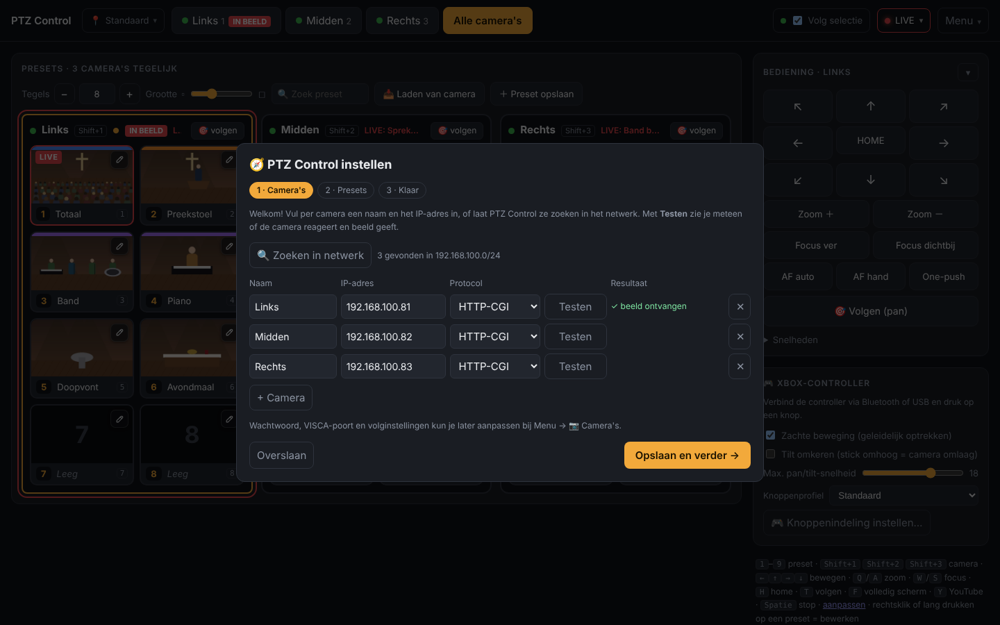

Of met de hand:
1. **Menu → 📷 Camera's** (menu rechtsboven): voeg je camera's toe (naam + IP). Gebruik HTTP-CGI; kies VISCA (TCP 5678) alleen als HTTP niet werkt.
   Een ingevuld **wachtwoord** wordt na het opslaan nooit meer getoond (het veld zegt *opgeslagen*): leeg laten houdt het, iets nieuws typen vervangt het, de gebruikersnaam leegmaken haalt het weg.
2. Je bestaande presets op de camera werken meteen. Rechtsklik, lang indrukken of ✎ op een tegel om een naam te geven
   en een **thumbnail** te maken van het huidige beeld.
3. **＋ Preset opslaan** → tik op een tegel: de huidige positie wordt opgeslagen en er wordt automatisch een thumbnail gemaakt.

## Rondleiding
De eerste keer dat je de bediening op een apparaat opent, start vanzelf een **rondleiding** die elke functie stap voor stap aanwijst
(presets, opslaan, laden, handbediening, volgen, Xbox-controller, sneltoetsen, YouTube en elk menu-item). Tijdens de rondleiding
reageren de camera's niet. Volgende: **→** of **Enter**, vorige: **←**, stoppen: **Esc**.
Later nog eens bekijken: **Menu → 🎓 Rondleiding**.

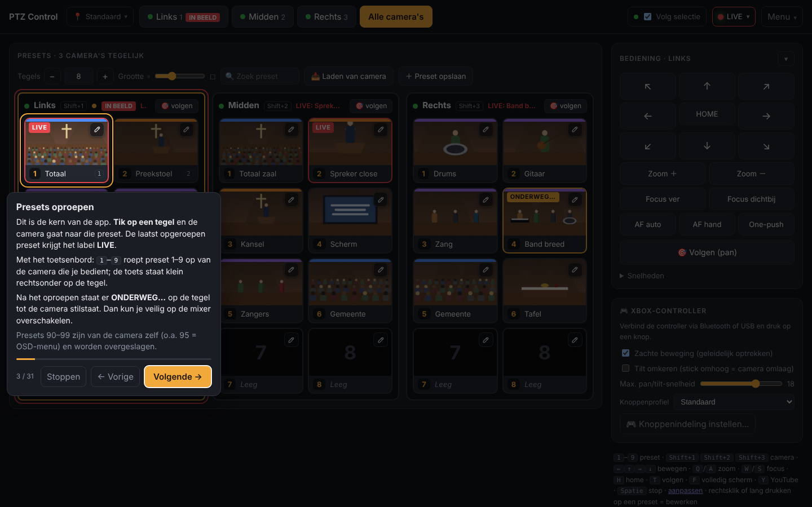

## Meerdere camera's tegelijk
Met 2 of meer camera's opent de app in **Alle camera's**: elke camera een kolom met de LIVE-preset en alle presettegels.
Klik op de kopregel van een kolom, of druk **Shift+1/2/3**, om te kiezen welke camera je bedient; je blijft in *Alle camera's*. Daarna roept **1–9** die preset op die camera op. Snel wisselen gaat dus zo: **Shift+1, 4** (camera 1 → preset 4), **Shift+2, 1** (camera 2 → preset 1). Werkt ook in volledig scherm. De toets per camera is instelbaar via **Menu → ⌨ Sneltoetsen** (klik in het veld en druk bijv. F1 of Num 1; Backspace = terug naar Shift+N). Daar staat ook een overzicht van alle vaste toetsen. Een rood veld betekent dat de toets al in gebruik is.
Met **Volg selectie** (rechtsboven) wisselen alle geopende schermen mee als ergens anders (of met de controller) een andere camera gekozen wordt.

**⛶ Volledig scherm** (in het menu onder 🎮 rechtsboven, of toets **F**) toont alle camera's over het hele scherm, zonder kopbalk en zijbalk; presets blijven klikbaar en de controller werkt gewoon. Sluiten met **Esc** of de knop **✕ Volledig scherm sluiten** rechtsboven in de presetbalk (die knoppen staan nooit over een tegel).
Op volledig scherm zijn er vier vensters: **camerabediening** (toets **C**), **Xbox-controller** (toets **X**), **YouTube** (toets **Y**) en **liederen** (toets **L**). Elke toets toont of verbergt zijn venster; **✕** in de titelbalk verbergt het ook. Alle vier zien er hetzelfde uit: titelbalk met badge, knoppen en (los) een greep om de grootte aan te passen. Met **📌** in de titelbalk zet je een venster **vast bovenaan**: alle vastgezette vensters staan naast elkaar tegen de bovenrand, worden even hoog als het hoogste venster en de camera's schuiven eronder (zo ver omlaag als nodig, maar nooit uit beeld; de inhoud van de bediening- en Xbox-kaart wordt zo nodig kleiner of groter geschaald). Klik nog eens op 📌, of sleep een venster aan zijn titel, om het **los** te laten zweven op een eigen plek (elk scherm onthoudt de plek). Ingeklapt (pijltje) blijft van een vastgezet venster alleen de titelbalk over. Buiten volledig scherm staan de bediening en de Xbox-controller gewoon in de zijbalk; daar klap je ze in en uit door op de titel te klikken, of met **C** en **X**. Elk scherm onthoudt welke vensters open zijn. Alle toetsen zijn aan te passen in **⌨ Sneltoetsen**.

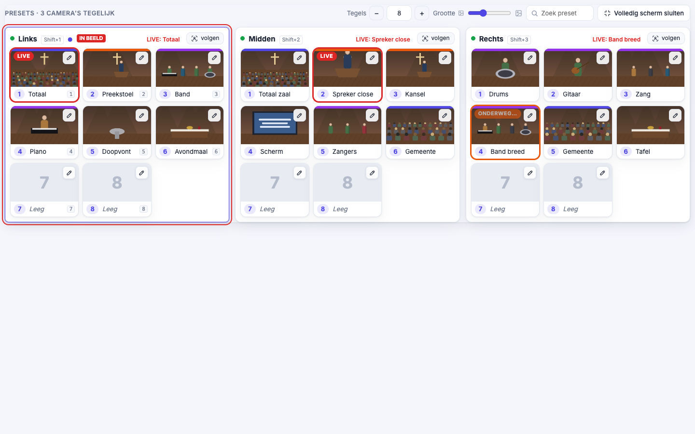

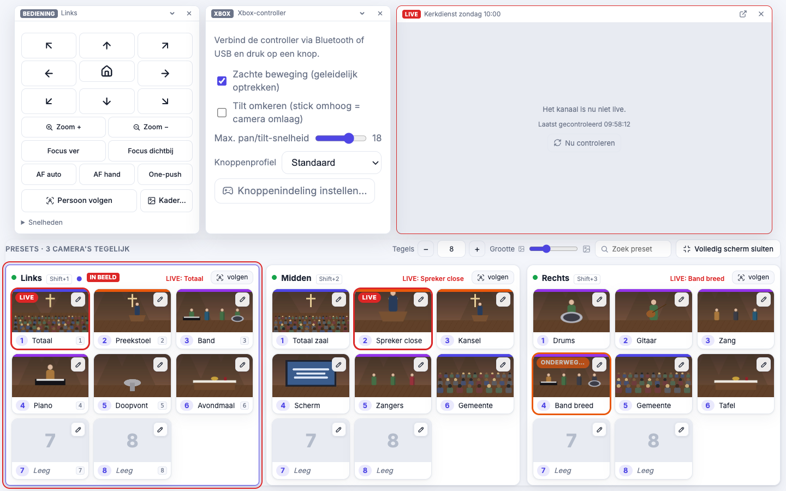

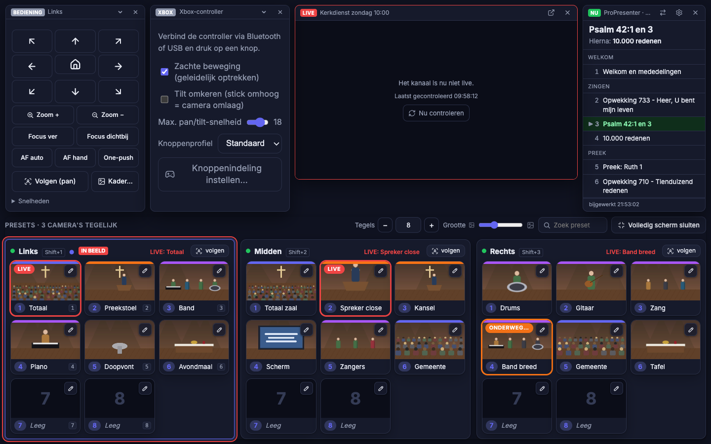

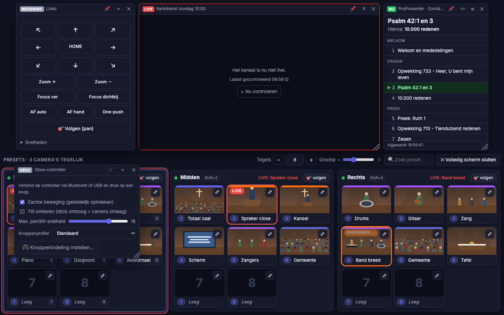

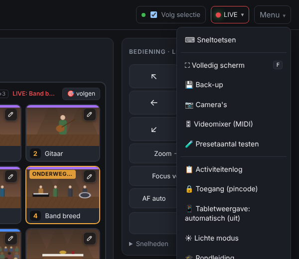


## Tijdens de dienst
- **ONDERWEG…** op een tegel: de camera rijdt nog naar die preset. Het label verdwijnt zodra hij stilstaat; dan kun je veilig op de mixer overschakelen. (De app leest daarvoor de positie van de camera uit; lukt dat niet, dan staat het label er 3 seconden.)
- **● Camerastatus**: het bolletje bij elke camera (kolom en tabblad) is groen als de camera bereikbaar is en rood als hij niet reageert, met *niet bereikbaar* erbij. De app controleert dit elke 10 seconden en bij elk commando.
- **Sneltoets op de tegel**: bij de camera die je bedient staat rechtsonder op tegel 1–9 de toets waarmee je die preset oproept.
- **↶ Ongedaan maken**: heb je een preset overschreven, dan verschijnt onderin 10 seconden *Ongedaan maken*. De camera gaat dan terug naar de oude positie, slaat de preset daar opnieuw op en zet de oude foto terug. Dat kan als de app de oude positie kent: van presets die je met de app opslaat (of uitleest bij Back-up) onthoudt hij die vanzelf.

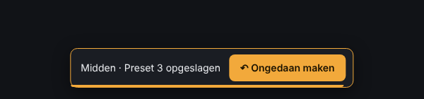

## Presets ordenen
- **Kleur**: geef een preset in het presetvenster (✎) een kleur; de tegel krijgt bovenaan een gekleurde streep. Handig per soort shot, bijv. blauw = totaal, oranje = spreker, paars = muziek.
- **Zoeken**: typ in *🔍 Zoek preset* een naam, nummer of kleur. Alleen de presets die passen blijven staan; **Esc** wist het.
- **Verslepen**: sleep een tegel met de muis naar een andere plek. Dat verandert alleen de volgorde op het scherm (per camera, voor alle schermen); het presetnummer in de camera blijft gelijk. **↺ Volgorde** zet alles terug op nummer.

## Presets laden van de camera
Staan er al presets in de camera's (bijv. gemaakt met het oude PTZOptics-programma of de afstandsbediening)? Klik op **📥 Laden van camera**
boven het presetraster. De camera's kunnen geen lijst van hun presets geven, dus de app roept preset 1 t/m het gekozen nummer op,
wacht tot de camera stilstaat en maakt een **foto** voor de tegel. Presets waarbij de camera niet beweegt, worden als leeg
overgeslagen. De positie wordt meteen bewaard voor de back-up; bestaande presetnamen blijven staan. Geef de gevonden presets
daarna een naam met ✎. ⚠ De camera's bewegen hierbij: niet tijdens een dienst.

**Gereserveerde presets:** PTZOptics gebruikt 90 (home), 95 (OSD-menu) en 91–99 voor vaste functies. De app roept deze nooit op
en slaat er niets onder op (ook niet via de Xbox-controller). Gebruik 1–89 of 100–254. Het OSD-menu open je via
**Menu → 🖥 OSD-menu camera** (zie hieronder).

## Presetaantal testen
Menu → **🧪 Presetaantal testen**. Test per camera hoeveel presets hij echt kan opslaan en oproepen (ca. 1 minuut per
camera; de camera's bewegen, dus niet tijdens een dienst). Bestaande presets worden daarna exact teruggezet en lege nummers
weer gewist. Het resultaat (bijv. "max. preset 254 · 244 bruikbaar") blijft bewaard en is later terug te zien.

## OSD-menu van de camera
Menu → **🖥 OSD-menu camera** bedient het menu van de camera zelf (belichting, kleur, beeld, enzovoort), net als met de
afstandsbediening. Kies de camera, klik **Menu openen** en navigeer met **▲▼◀▶**, **OK** en **↩ Terug**. Dat kan ook met het
toetsenbord (pijltjes, Enter = OK, Backspace = terug) of de Xbox-controller (D-pad of linker stick, A = OK, B = terug).
**📷 Beeld bekijken** haalt één foto van de camera op, zodat je ziet waar je in het menu bent (geen live beeld).

- ⚠ **Het menu staat ook in de livestream.** Zet eerst op de videomixer een andere camera in beeld. Staat de camera
  *IN BEELD*, dan vraagt de app eerst of je het zeker weet.
- Zolang het menu open is, staat er **OSD-MENU** bij de camera (op alle schermen) en reageert die camera niet op presets,
  handbediening, volgen of back-uptaken: die commando's zouden anders door het menu lopen.
- **Venster sluiten = menu dicht** op de camera. Na 5 minuten zonder OSD-knop neemt de app aan dat het menu dicht is
  (bijv. dichtgedaan met de afstandsbediening). Wisselen van workspace of afsluiten sluit het menu ook.
- Werkt via VISCA (TCP-poort 5678), ook als de camera op HTTP-CGI staat.

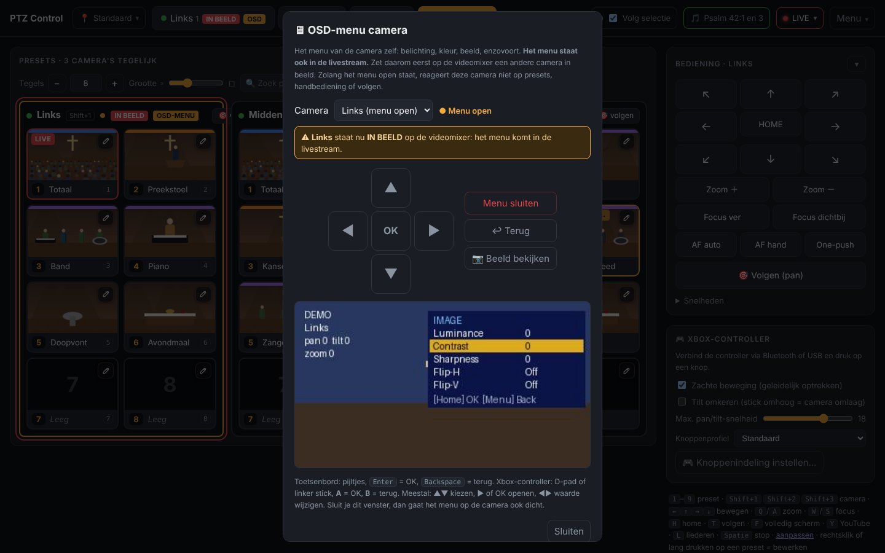

## Tegels instellen
Boven het presetraster: **Tegels − 12 +** bepaalt hoeveel presettegels je per camera ziet (90–99 worden overgeslagen),
**Grootte** de tegelgrootte. Beide worden automatisch opgeslagen en gelden op elk scherm. Staan er presets met een naam of
foto buiten beeld, dan zie je een melding; klik erop om ze te tonen.

## Back-up van presets en camera-instellingen
**💾 Back-up** in het menu onder 🎮 rechtsboven:

1. **Back-upbestand downloaden / terugzetten**: cameralijst, presetnamen, volg-instellingen, thumbnails en (als uitgelezen)
   presetposities en beeldinstellingen in één `.json`-bestand. Wachtwoorden alleen als je dat aanvinkt; zonder wachtwoorden houdt
   terugzetten de huidige wachtwoorden.
2. **Uit de camera's lezen**: per preset pan/tilt/zoom/focus en de beeldinstellingen (belichting, witbalans, kleur, scherpte,
   flip/mirror). ⚠ De camera's **rijden langs al hun presets**, niet doen tijdens een dienst. Daarna gaat elke camera terug naar de
   preset die LIVE stond.
3. **Naar de camera's terugzetten**: rijdt naar de bewaarde posities, slaat de presets opnieuw op en zet het beeld terug.
   Handig na een fabrieksreset of bij een vervangende camera (pas dan eerst het IP aan bij ⚙ Camera's).

Tip: lees de camera's uit en download een back-up na elke wijziging aan de presets. Dit gaat via VISCA (TCP-poort 5678).

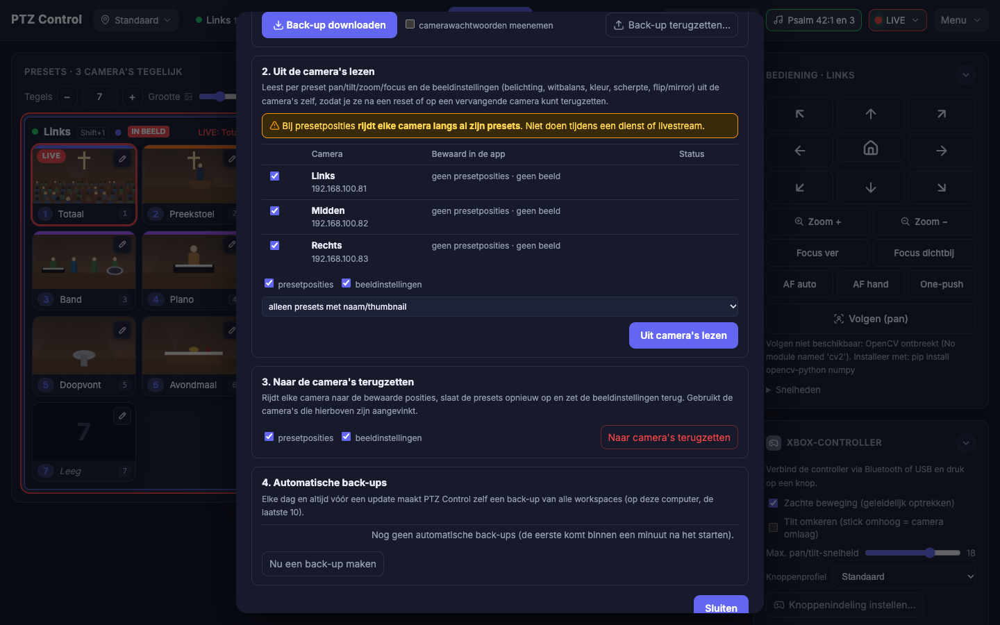

## Automatische back-up
PTZ Control maakt **elke dag** en **altijd vóór een update** zelf een back-up van alle workspaces (camera's, presets, foto's, instellingen) op de computer waar de app draait. De laatste 10 blijven bewaard. Je vindt ze onderaan in **Menu → 💾 Back-up** (*4. Automatische back-ups*): per back-up **Terugzetten…** of **⬇** om te downloaden, en **Nu een back-up maken**.

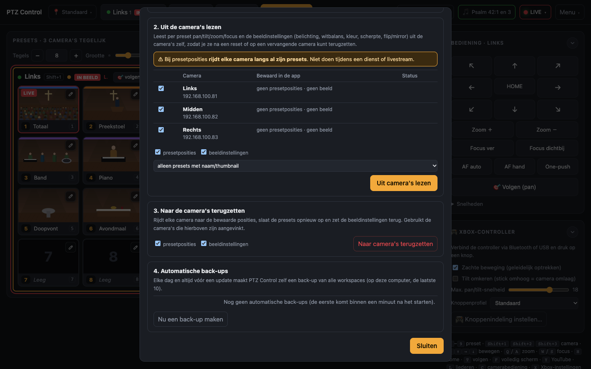

## Pincode en alleen kijken
Zonder pincode kan iedereen op het kerknetwerk de camera's bedienen. Met **Menu → 🔒 Toegang (pincode)** stel je een pincode in (4–8 cijfers):
- Andere apparaten (telefoon, tablet, laptop) kunnen dan **alleen meekijken**: presets, *IN BEELD*, de livestream. Rechtsboven staat **🔒 Alleen kijken** en bovenin een gele balk. Tik je op een preset, dan vraagt de app de pincode.
- Na de pincode blijft dat apparaat ingelogd (half jaar). **Dit apparaat vergrendelen** en **Alle apparaten uitloggen** staan in hetzelfde venster.
- **Op de computer waar PTZ Control draait is nooit een pincode nodig**, zodat je jezelf niet kunt buitensluiten. Pincode vergeten? Daar kun je hem wijzigen of weghalen.
- Na 5 foute pogingen moet een apparaat een minuut wachten. De pincode wordt niet leesbaar opgeslagen.

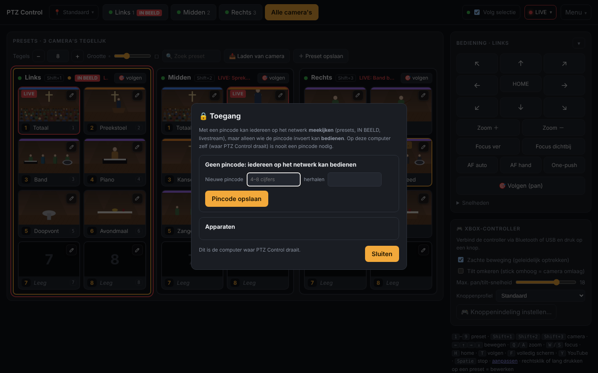

## Foutmelding op alle schermen
Valt er tijdens de dienst iets weg, dan verschijnt bovenaan op **alle schermen** een rode balk, ook op volledig scherm:

- een **camera niet bereikbaar** (gecontroleerd elke 10 seconden en bij elk commando);
- de **videomixer niet verbonden** (alleen als de koppeling aan staat);
- **geen verbinding met PTZ Control** zelf (bijvoorbeeld als de Mac uit of in slaap is).

Is alles weer in orde, dan wordt de balk even groen en verdwijnt hij. **Verbergen** haalt hem weg op dit scherm, tot er een nieuwe fout bij komt. **Bekijk log** opent het activiteitenlog.

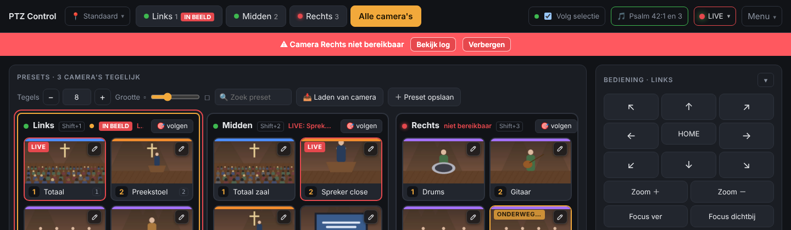

## Oefenstand
Met **Menu → 🚧 Oefenstand** oefen je zonder dat er iets beweegt in de kerk, handig voor nieuwe vrijwilligers. PTZ Control maakt een tijdelijke kopie van de huidige workspace (camera's, presets, foto's, knoppen) en bedient **nagebootste camera's** in plaats van de echte. Presets oproepen, handbediening, opslaan, ongedaan maken en de Xbox-controller werken zoals altijd; een nieuwe foto toont een getekend beeld met *OEFENEN* erin.

- Geldt voor **alle schermen** tegelijk: een oranje balk en rand laten zien dat je oefent.
- De **videomixer wordt losgekoppeld** (anders zou IN BEELD verwarren).
- Wat je verandert, wordt **niet bewaard**. Stoppen via de balk of het menu; daarna is alles weer zoals ervoor.
- Workspaces wisselen kan niet tijdens de oefenstand. Na een herstart van PTZ Control staat de oefenstand uit.
- **Niet tijdens een dienst gebruiken**: ook de schermen van anderen gaan dan naar de oefenstand.

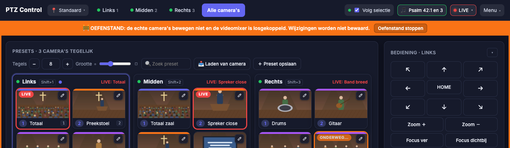

## Activiteitenlog
Met **Menu → 📋 Activiteitenlog** zie je achteraf wat er gebeurd is:

- **wie wat deed en vanaf welk apparaat**: presets oproepen en opslaan, handbediening, home, volgen, foto's, instellingen, back-ups, workspaces, pincode;
- **fouten**: camera niet bereikbaar (en weer terug), commando mislukt, videomixer weg, foute pincode, bediening geweigerd;
- **wat er gebeurde**: welke camera op de mixer in beeld stond, YouTube-stream live of afgelopen, back-up- en laadtaken klaar, nieuwe versie;
- **welke liederen er gezongen zijn** (soort *Liederen*), uit ProPresenter en de Voordienst app, zie [Liederen](#liederen-propresenter-en-voordienst-app).

Geef elk apparaat onderin het venster een **naam** (bijv. *iPad regie*); die komt dan in het log in plaats van alleen het IP-adres. Handbediening en herhalingen binnen een minuut worden samengevoegd (×3). Nieuwe fouten zie je als rood getal achter het menu-item. Filteren op soort of camera, zoeken en **⬇ Downloaden** als tekstbestand kan ook. Het log staat in `activiteit.log` in de instellingenmap (laatste 2000 regels, één log voor alle workspaces) en blijft bewaard na een herstart.

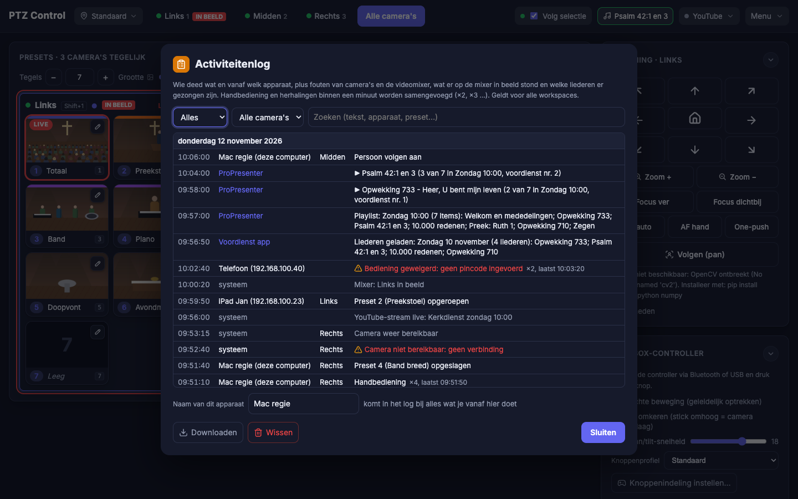

## Tabletweergave
Op een iPad of tablet (aanraakscherm) gaat de **tabletweergave** vanzelf aan: grote tegels van één camera en onderin een balk met grote knoppen om de camera te kiezen, met *IN BEELD* en het statusbolletje. Zelf aan/uit/automatisch: **Menu → 📱 Tabletweergave** (per apparaat).

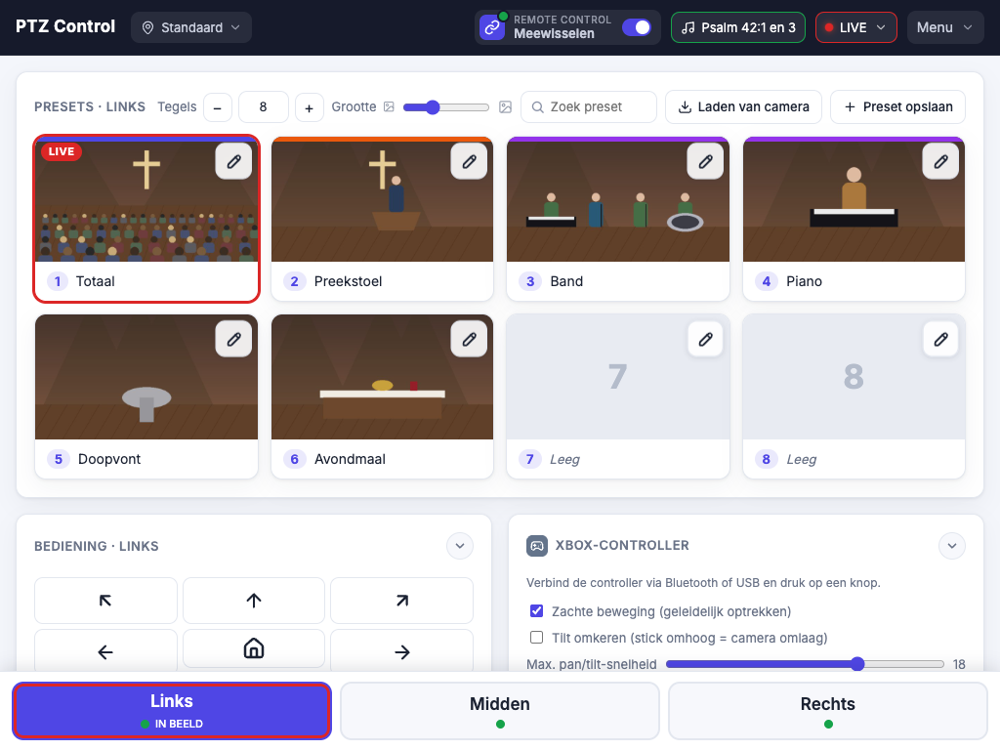

## Persoon volgen (alleen pan)
De app kan een spreker volgen die over het podium loopt. Alleen **pan** wordt bijgestuurd; tilt en zoom blijven zoals de preset ze zet.

Installeren op de pc waar de app draait:
```
pip install opencv-python numpy          # verplicht
pip install ultralytics                   # aanbevolen: nauwkeuriger (YOLO), liefst met een NVIDIA-GPU
```
Zonder `ultralytics` gebruikt de app **YOLOX-tiny** via OpenCV, als het modelbestand er is (`python3 packaging/haal_model.py` zet het in `models/`). De losse app heeft dit model al ingebouwd.
Beide herkennen ook een **half silhouet** (ingezoomd op het bovenlichaam). Alleen als er geen van beide is, valt hij terug op de oude OpenCV-detector, en die ziet alleen **hele** personen van top tot teen: ingezoomd blijft hij dan op *zoekt persoon* staan. Onder de volgknop staat welke detector gebruikt wordt.

Gebruik:
- **🎯 volgen** in de kolomkop (of de knop in de bediening, of toets **T**) zet volgen aan/uit. De status staat erbij: *volgt*, *zoekt persoon*, *geen beeld*.
- In het preset-venster (✎): **Na oproepen automatisch volgen**. Bijv. "Preekstoel": camera gaat naar het shot en begint na 2,5 s te volgen.
- Handbediening, home of een andere preset op die camera zet volgen direct uit. Zoom en focus mogen tijdens het volgen.
- Bij meerdere mensen in beeld kiest hij de grootste (meestal de spreker vooraan) en blijft daarna bij diezelfde persoon.
- ⚙ Camera's per camera: **Volg-stream** (standaard `rtsp://IP:554/2`, de lichte substream), **max. volgsnelheid** en **pan omgekeerd** voor een ondersteboven gemonteerde camera.

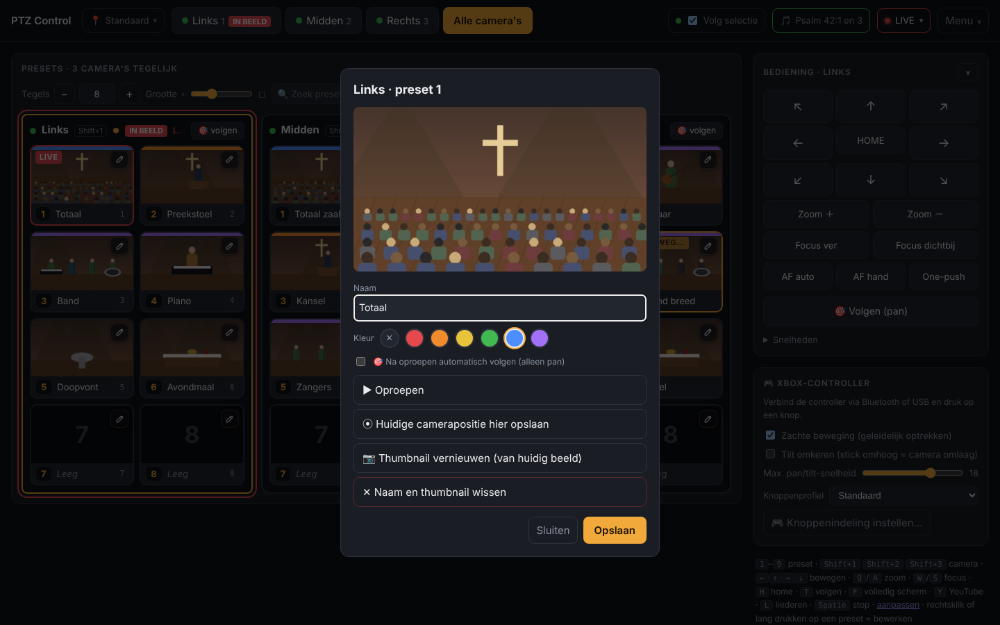

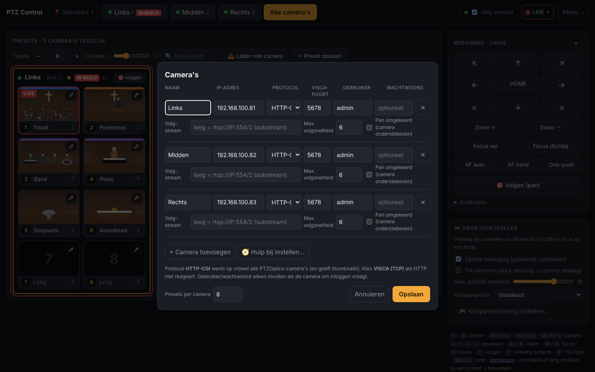

## Xbox-controller
Verbind de controller via Bluetooth of USB met de Mac (of iPad/tablet) waarop de bediening open staat en druk op een knop.
De controllerstatus staat in de Xbox-kaart in de zijbalk (groen *Verbonden*). Het **Menu** rechtsboven bevat Sneltoetsen, Volledig scherm, Back-up, Camera's, Videomixer (MIDI), Presetaantal testen, OSD-menu camera, Oefenstand, Activiteitenlog, Toegang (pincode), Tabletweergave, thema, Rondleiding, Op updates controleren en afsluiten. Zachte beweging, tilt omkeren en max. snelheid staan in de zijbalk onder de camerabediening.

**Knoppenprofielen (per persoon):** in de Xbox-kaart kies je bij *Knoppenprofiel* welke knoppenindeling deze controller gebruikt. In *Knoppenindeling instellen…* maak je een nieuw profiel (begint als kopie van het huidige), hernoem of verwijder je het. Elk scherm onthoudt zelf welk profiel actief is; de profielen staan in de back-up.

**Zachte beweging** (standaard aan): de camera trekt geleidelijk op (ca. 1 seconde naar topsnelheid) en de stick reageert fijner rond het midden. Uitzetten geeft direct de volle snelheid.

Sticks en triggers liggen vast. De knoppen stel je per knop in via **Knoppenindeling instellen…** in de Xbox-kaart (druk in dat venster op een knop van de controller en de regel licht op); die indeling staat in `cameras.json` en geldt dus voor alle schermen. Standaard:

| Controller | Functie |
|---|---|
| Linker stick | Pan/tilt, snelheid naar hoe ver je duwt (indrukken = fijn-modus) |
| RT / LT | Zoom in / uit, snelheid naar hoe diep je drukt |
| Rechter stick ↑/↓ | Focus ver / dichtbij (indrukken = autofocus) |
| A · B · X · Y | Preset 1–4 · met LB (Shift) ingedrukt: 5–8 |
| ☰ Menu + A/B/X/Y | Huidige positie opslaan als preset (trilt ter bevestiging) |
| D-pad ←/→ | Vorige / volgende camera · ↓ home (↑ vrij) |
| RB | Volgen (pan) aan/uit · View = alles stoppen |

Elke knop kan ook worden: een vaste camera, een andere preset, home, volgen, autofocus, fijn-modus, alles stoppen, of niets.
**Shift** telt bij presets een instelbaar getal op (standaard 4); **Opslaan** vasthouden + presetknop slaat de huidige positie op.

De bediening-pagina moet open en zichtbaar zijn (de browser geeft de controller alleen door aan het actieve tabblad).
Gaat het tabblad naar de achtergrond, dan stopt elke beweging automatisch.

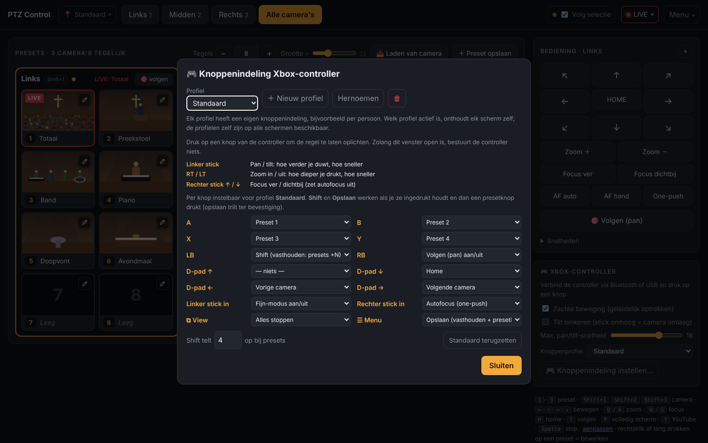

## YouTube-livestream bekijken
Klik op de **YouTube**-knop rechtsboven → *Kanaal instellen…* en vul het kanaal in (`@kerknaam`, een kanaal-id `UC…` of de link naar het kanaal). Een link naar één stream (`youtube.com/live/…`) mag ook, maar dan volgt hij alleen die ene stream.
**Na het bijwerken van de app altijd PTZ Control opnieuw starten** (Terminal-venster sluiten, app weer openen), anders draait de server nog de oude versie.
De app kijkt daarna elke minuut of het kanaal live is. De knop rechtsboven wordt rood (**● LIVE**) zodra er een stream loopt,
en de stream verschijnt in een **klein venster** (standaard automatisch, zonder geluid).

- Het venster zoekt zelf een vrije plek naast of onder de presettegels en schuift mee als je het aantal tegels verandert. Is er op volledig scherm geen plek, dan houdt de app rechts een strook vrij en schuiven de tegels op.
- Zelf verplaatsen: sleep aan de titelbalk (dan blijft het daar staan; ⌖ zet het weer automatisch). Groter/kleiner: sleep het hoekje rechtsonder (of kies Klein/Middel/Groot in het YouTube-menu).
- Klik op de YouTube/LIVE-knop voor een keuzemenu: venster tonen/verbergen, automatisch plaatsen, grootte, geluid, automatisch openen, nu controleren, openen op YouTube en kanaal instellen. Toets **Y** toont/verbergt het venster direct.
- Positie, grootte, automatisch openen en geluid onthoudt elk apparaat zelf; het kanaal geldt voor alle schermen.
- Alleen kijken: de stream starten en stoppen gebeurt nog steeds buiten deze app. Let op: de stream loopt een paar seconden achter.
- Het kanaal kun je altijd wijzigen, ook terwijl er een stream loopt.

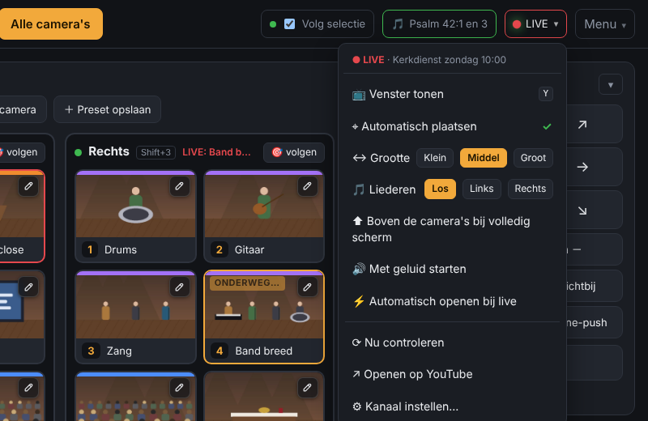

## Videomixer (Roland V-1HD)
Sluit de V-1HD met een **USB-kabel** aan op de computer waar PTZ Control draait en open Menu → **🎛 Videomixer (MIDI)**.

- Vink **Koppeling met de videomixer aan** aan. Bovenin staat of de mixer gevonden is.
- Het venster toont beide rijen van de mixer (A en B, elk knop 1–4). Beide rijen kiezen uit dezelfde vier HDMI-ingangen, dus je kiest per ingang één keer welke camera erop zit. Druk je op de mixer op een knop, dan licht hij in het venster op; de gekozen ingang op de live rij is rood, net als op de mixer.
- De camera die op de mixer gekozen is, krijgt in de app een **rode rand** en **IN BEELD** (in de kolom en op het tabblad). Zo zie je meteen welke camera je niet moet verplaatsen.
- **Live rij**: de rij aan de kant waar de fader staat (de fader wordt niet gebruikt). Standaard A.
- **Verkenning**: legt alles vast wat de mixer via MIDI stuurt. Start, druk op de knoppen van beide rijen en kies een memory, en klik **⬇ Log downloaden**. Handig als de koppeling niet klopt.
- Op de mixer: SETUP → MIDI → *MIDI OUT* op **OUT** (via USB stuurt hij altijd).

De koppeling geldt voor alle schermen en wordt per workspace en in de back-up bewaard. Nodig zijn de packages `mido` en `python-rtmidi` (installeert de starter vanzelf).

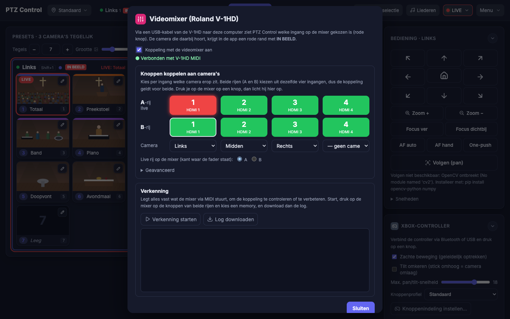

## Liederen (ProPresenter en Voordienst app)
Met Menu → **🎵 Liederen (ProPresenter)** ziet PTZ Control welke nummers er gezongen worden. Elk nummer komt in het **📋 Activiteitenlog** (filter *Liederen*), met de plek in de playlist en het nummer uit de Voordienst app. De camera's bewegen hierdoor niet.

- **ProPresenter**: zet in ProPresenter *Instellingen → Netwerk* → **Netwerk inschakelen** aan. Vul in PTZ Control het IP-adres van die computer en de poort in (staan in hetzelfde ProPresenter-scherm; `127.0.0.1` als ProPresenter op dezelfde computer draait). PTZ Control kijkt elke 2 seconden welke presentatie op het scherm staat en welke playlist actief is. In het log: *Playlist: Zondag 10:00 (7 items): …* en per nummer *▶ Opwekking 733 – … (2 van 7 in Zondag 10:00, voordienst nr. 1)*. Hetzelfde nummer na een leeg scherm komt er niet twee keer in. Werkt met ProPresenter 7.9 en nieuwer; PTZ Control vraagt alleen informatie op en wijzigt niets in ProPresenter.
- **Voordienst app**: vul het **API-adres** van de liederen in (`https://…`) en het **API-token** dat je in de Voordienst app aanmaakt. PTZ Control stuurt het mee als `Authorization: Bearer <token>` en leest de lijst opnieuw met de ingestelde **ophaalfrequentie** (standaard elke 10 seconden, instelbaar van 2 tot 600). Het token wordt na het opslaan nooit meer getoond (ook niet aan andere schermen) en zit niet in een back-up zonder wachtwoorden; met **Wissen** haal je het weg. Bij een nieuwe of gewijzigde lijst komt *Liederen geladen: … (n liederen): …* in het log; een ongeldig of verlopen token geeft een fout (*HTTP 401*). Verwacht formaat:
  ```json
  {"titel": "Zondag 10 november",
   "liederen": ["Opwekking 733", "Psalm 42:1 en 3", "10.000 redenen"],
   "huidig": 2}
  ```
  **Huidig lied (groen)**: vul bij *veld voor het huidige lied* in welk veld de Voordienst app gebruikt. Dat mag een veld bovenaan zijn met het nummer of de naam (`"huidig": 2`, genest mag ook: `dienst.huidig`), of een vlag per lied (`{"titel": "Psalm 42", "status": "bezig"}` met veld `status`, of `"actief": true`; ook `ja`, `1`, `live` tellen). Leeg = automatisch (`huidig`, `actief`, `current`, `now` …). Verandert het veld, dan springt de groene markering bij de volgende keer ophalen naar het nieuwe lied (in het liederenvenster en het instellingenvenster) en komt er een *▶*-regel in het log. Het nummer telt alleen de liederen, niet de mededelingen of de preek.
  `liederen` mag ook `items`, `songs` of `nummers` heten, en de items mogen objecten zijn (`{"type": "lied", "titel": "…"}`; staan er ook andere soorten in, dan tellen alleen de liederen). `huidig` (nummer vanaf 1, of de naam) is optioneel. Tekst met één lied per regel werkt ook, en zonder token mag het ook een `.json`/`.txt`-bestand op deze computer zijn.
- **Liederenvenster** (net als het YouTube-venster): zodra er iets gekoppeld is, staat in de kop een knop **🎵** met het nummer dat nu op het scherm staat. Klik erop, of druk op **L**, voor een klein venster met **Nu**, **Hierna** en de hele playlist (het huidige nummer groen). Verslepen aan de titelbalk, groter maken met het hoekje rechtsonder; elk scherm onthoudt zijn eigen plek en of het venster open was. Met **⇄** wissel je tussen de playlist uit ProPresenter en de lijst uit de Voordienst app, met **⚙** open je de instellingen. Werkt ook op volledig scherm.
- Het instellingenvenster toont de playlist en de liederen uit de Voordienst app met het nummer dat nu op het scherm staat. **↻ Nu controleren** leest beide meteen opnieuw; **📋 In het log bekijken** opent het log met alleen de liederen.

De instellingen gelden voor alle schermen en worden per workspace en in de back-up bewaard.

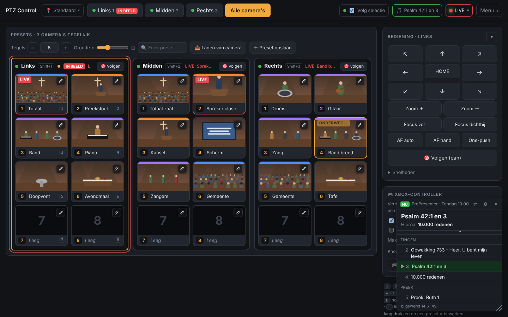 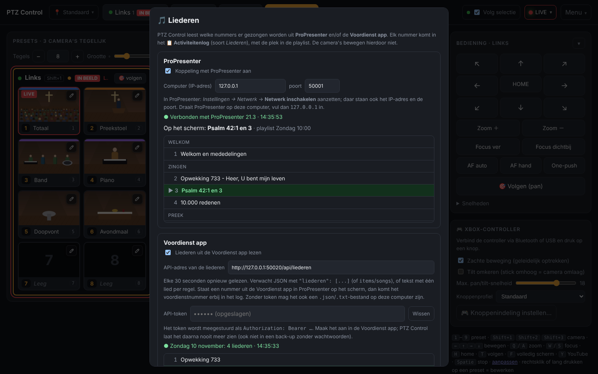 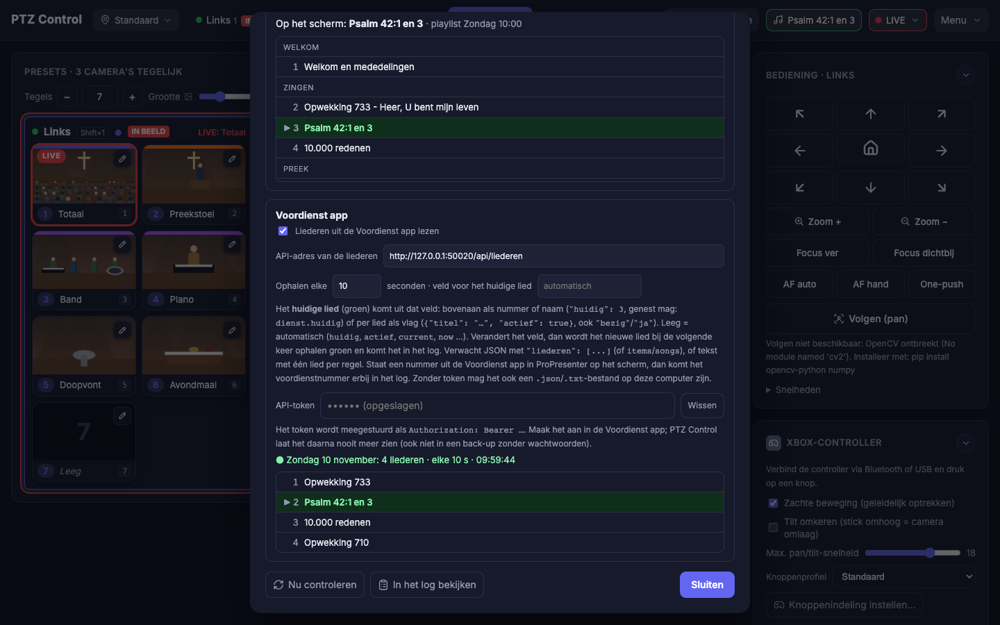

## Licht of donker
Menu → **☀ Lichte modus / 🌙 Donkere modus** wisselt direct. Elk apparaat onthoudt zijn eigen keuze.

De vormgeving volgt de huisstijl van de Voordienst app: lichtgrijze achtergrond met witte kaarten, één hoofdkleur (indigo) voor selectie en knoppen, een donkere kopbalk en het lettertype Inter (zonder internet valt de app terug op het systeemlettertype). Rood = LIVE/fout, groen = in orde, amber = let op, oranje = onderweg/oefenstand.

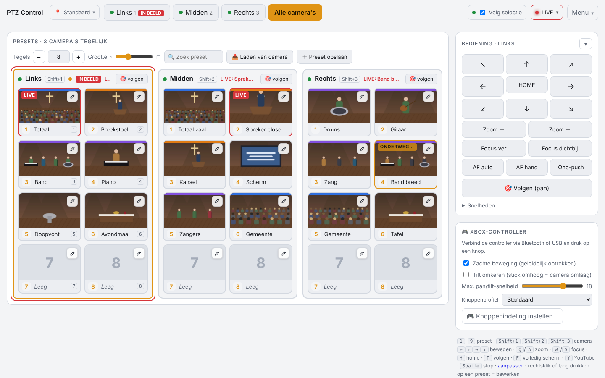

Op een telefoon of smalle tablet staan de onderdelen onder elkaar:

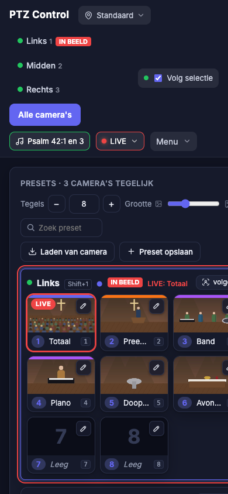

## Workspaces (per locatie)
Klik op **📍 Standaard ▾** naast de titel. Een workspace is een aparte set camera's, presets, foto's, sneltoetsen, knoppenindeling en YouTube-kanaal, alsof het een aparte installatie is.
- *Nieuwe workspace…*: kies een naam en begin leeg of als kopie van een bestaande.
- Wisselen geldt voor alle schermen die met deze computer verbonden zijn (ze herladen vanzelf). Volgen stopt bij het wisselen.
- *Workspaces beheren…*: hernoemen, openen of verwijderen (verwijderen wist alles van die workspace; maak eerst een back-up als je het wilt bewaren).
- **Back-ups:** Menu → 💾 Back-up maakt een back-up van de workspace die nu open is (de naam staat in het bestand). Vink *alle workspaces* aan voor één bestand met alles. Bij terugzetten kies je: in de huidige workspace, of als nieuwe workspace. Een back-up van alle workspaces zet ze allemaal terug (workspaces die er niet in staan blijven staan).
- Direct in een bepaalde workspace starten: `python3 ptz_control.py --workspace "Kerk Zwolle"` (ook als extra argument achter `Start PTZ Control`).

## Sneltoetsen
Standaard: pijltjes = bewegen · Q/A = zoom · W/S = focus · 1–9 = preset · Shift+1–9 = camera kiezen · H = home · T = volgen · F = volledig scherm · C = camerabediening · X = Xbox-instellingen · Y = YouTube-venster · L = liederenvenster · Spatie = stop · Esc = volledig scherm/opslaan-modus verlaten.
**Alle toetsen zijn aan te passen** via Menu → ⌨ Sneltoetsen (of *aanpassen* onder de bediening): klik in een veld en druk de nieuwe toets of combinatie. Backspace = standaard, Delete = uitzetten. Esc blijft vast. De instelling geldt voor alle schermen.

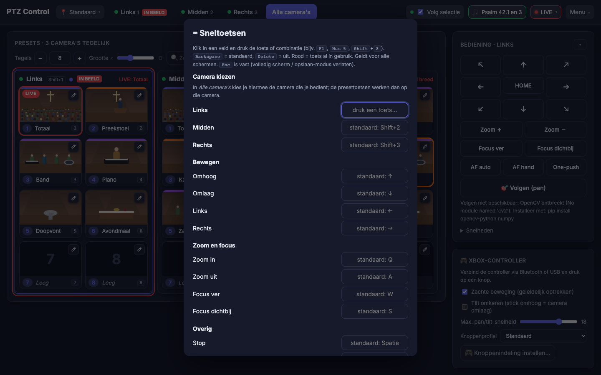

## Updates
PTZ Control kijkt zelf elke 6 uur (en kort na het starten) of er een nieuwe versie is. Is die er, dan verschijnt **rechtsonder** een melding met wat er nieuw is. Zelf kijken: **Menu → 🔄 Op updates controleren**.

- **Nu bijwerken** (versie via *Start PTZ Control* / git): de app haalt de nieuwe versie op (`git pull`), werkt zo nodig de packages bij en start zichzelf opnieuw. De bediening is dan ongeveer 10 seconden weg; open schermen verversen vanzelf. ⚠ Niet tijdens een dienst.
- **Map zonder git** (bijv. de code als ZIP van GitHub gedownload, of git staat niet op deze computer): **Nu bijwerken** stapt over op de **losse app**. Die wordt gedownload en komt in dezelfde map in plaats van de Dock-snelkoppeling `PTZ Control.app`, dus het Dock-icoon blijft werken. Op Windows komt `PTZ Control.exe` op de vaste plek `%LOCALAPPDATA%\Programs\PTZ Control` en wijst de snelkoppeling *PTZ Control* in Startmenu en op het bureaublad voortaan naar de .exe. Je instellingen, presets en foto's worden gekopieerd naar de vaste plek buiten de app (Mac: `~/Library/Application Support/PTZ Control`, Windows: `%APPDATA%\PTZ Control`); wat daar al stond, gaat naar een submap `voor-overstap-<datum>`. `cameras.json` in de oude map heet daarna `cameras.json.overgezet` (reservekopie). Vanaf dan werkt de losse app zichzelf bij.
- **Later** verbergt de melding voor die versie op dit apparaat. Op volledig scherm blijft de melding altijd weg.
- Lukt automatisch bijwerken niet (bijv. omdat er op deze computer bestanden zijn aangepast), dan zegt de melding dat; werk dan bij met `git pull` en start de app opnieuw.
- Wat er nieuw is komt uit de releasenotes: `docs/releasenotes/<versie>.md` als die er is (zie [`docs/releasenotes/README.md`](docs/releasenotes/README.md)), anders maakt de bouwstap ze uit de commitberichten sinds de vorige versie.
- **Losse app (.exe/.app):** ook die werkt zichzelf bij: **Nu bijwerken** downloadt de nieuwe versie van GitHub (Releases), sluit de app, zet de nieuwe ervoor in de plaats en start hem opnieuw. Op Windows gebeurt dat zonder hulpvenster: de app zet de nieuwe .exe zelf op zijn plek (de oude heet even `PTZ Control.exe.oud` en verdwijnt bij de volgende start) en de nieuwe versie start zodra de oude gestopt is. Mag de app zijn eigen map niet overschrijven (bijv. een .app die door een beheerder in *Programma's* is gezet), dan blijft de oude staan en opent Finder/Verkenner de gedownloade versie, zodat je hem zelf kunt vervangen.
- Uitzetten: start met de omgevingsvariabele `PTZ_UPDATE=0`.

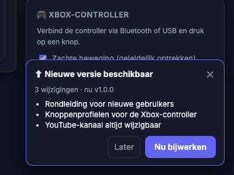

## Tip
Geef de pc met deze app een vast IP-adres (DHCP-reservering), dan blijft het tabletadres hetzelfde.

## Losse app (zonder Python installeren)
Er is ook een kant-en-klare app: **`PTZ-Control-…-Windows.exe`** en **`PTZ-Control-…-macOS.zip`** (Mac met Apple-chip).
Download ze bij **Releases** op GitHub (of onder *Actions → Losse app bouwen → Artifacts*).

- **Windows:** dubbelklik op de .exe. De eerste keer: SmartScreen → *Meer informatie* → *Toch uitvoeren*, en bij de firewall *Privénetwerken* toestaan (anders kunnen andere schermen niet meedoen). Er verschijnt een camera-icoon in het systeemvak (rechtsonder, eventueel onder ^).
- **Windows – installeren:** draait de .exe nog niet vanaf de vaste plek (bijv. uit *Downloads*), dan vraagt hij één keer of hij geïnstalleerd mag worden. Bij **Ja** zet hij zichzelf in `%LOCALAPPDATA%\Programs\PTZ Control` (geen beheerdersrechten nodig), maakt hij een snelkoppeling **PTZ Control** in het Startmenu en op het bureaublad (kan aan de taakbalk) en start hij vanaf daar; het gedownloade bestand mag je daarna weggooien. Bij **Nee** draait hij vanaf de huidige plek; later alsnog installeren kan via het icoon in het systeemvak (*Installeren op deze computer…*). Zet hem niet in *Program Files*: daar kan hij zichzelf niet bijwerken. Draagbaar gebruik (een `cameras.json` naast de .exe) vraagt niets.
- **macOS:** pak de zip uit en zet **PTZ Control.app** in *Programma's*. De app is niet door Apple gecontroleerd: de eerste keer weigert macOS hem. Ga dan naar *Systeeminstellingen → Privacy en beveiliging* en klik bij PTZ Control op *Toch openen* (of in Terminal: `xattr -dr com.apple.quarantine "/Applications/PTZ Control.app"`). Sta daarna *Lokaal netwerk* toe, anders bereikt hij de camera's niet. De app heeft geen Dock-icoon maar een icoon in de **menubalk** (rechtsboven).
- Via het icoon: *Bediening openen*, het adres voor andere schermen, *Map met instellingen openen* en *Afsluiten*. Afsluiten kan ook in de bediening: Menu → **⏻ PTZ Control afsluiten**. Nog een keer op de app klikken terwijl hij draait opent alleen de bediening.
- **Instellingen en foto's** staan bij de losse app in een eigen map: Windows `%APPDATA%\PTZ Control`, Mac `~/Library/Application Support/PTZ Control`. Overstappen vanaf de Python-versie: maak daar een **Back-up** (met wachtwoorden) en zet die terug in de app, of kopieer `cameras.json` en de map `thumbs` naar die map.
- **Persoon volgen** werkt in de losse app met de ingebouwde YOLOX-detector (via OpenCV, zonder torch); die herkent ook een half silhouet. De Python-versie (`Start PTZ Control`) gebruikt YOLOv8 op de Apple-chip.
- Een nieuwe versie maken: GitHub → *Actions* → **Losse app bouwen** → *Run workflow* → vink **Release maken** aan en vul de versie in (bv. `1.1.0`). GitHub maakt dan zelf de tag, bouwt beide apps en zet ze bij Releases. Zonder vinkje wordt alleen gebouwd (downloads onder *Artifacts*).

## Screenshots bijwerken
De afbeeldingen in deze README zijn gemaakt met nagemaakte demodata; opnieuw maken: zie [`docs/tools/README.md`](docs/tools/README.md).
